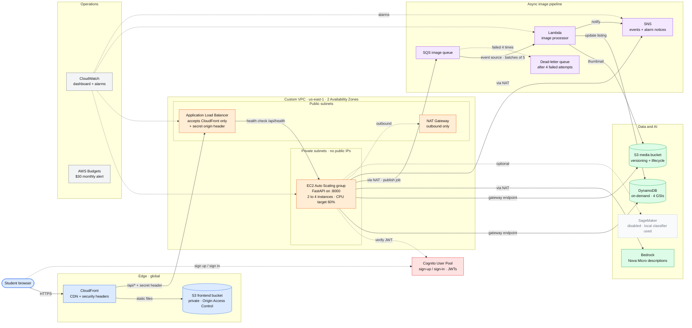

# CampusConnect

**CloudScale semester project | CS-4075 Cloud Computing**

CampusConnect is a campus community board for lost-and-found posts, textbook exchange, housing, events, and student requests. This repository contains the application, AWS infrastructure as code, local demo data, deployment notes, and the project report.

**Private source repository:** [github.com/AwaisBasheer/CloudScale](https://github.com/AwaisBasheer/CloudScale). Access is intended for the course instructor and assigned TA.

## Live deployment

**Frontend:** [https://d39xic7jvhqh80.cloudfront.net](https://d39xic7jvhqh80.cloudfront.net)<br>
**API health:** [https://d39xic7jvhqh80.cloudfront.net/api/health](https://d39xic7jvhqh80.cloudfront.net/api/health)

At the last check, the frontend and API health endpoint returned HTTP 200. The API reports AWS mode with Cognito, DynamoDB, S3, Bedrock description assistance, local category suggestions, and AWS notifications selected.

**Current limitations:** the live listings endpoint returned an empty list at the last check. The user later stopped one EC2 instance; Auto Scaling replacement status has not been rechecked. Cognito signup, authenticated CRUD, uploads, queued image processing, SNS delivery, and Bedrock inference have not been verified end to end. SageMaker is disabled. Check [project status](docs/project-status.md) before relying on the live environment.

## Architecture



**Legend:** blue = edge, orange = compute and networking, green = data and AI, purple = async pipeline, red = identity, grey = operations. Solid arrows are the main request path. Dotted arrows are auth, monitoring, optional or failure paths.

### How a request flows

1. The browser loads the React app from CloudFront, which serves it from a private S3 bucket.
2. The user signs up or signs in with Cognito and receives a JWT.
3. API calls to `/api/*` go through CloudFront to the ALB. The ALB only accepts CloudFront's IP range and requests carrying the secret origin header.
4. The ALB forwards healthy traffic to FastAPI on EC2 instances in private subnets across two AZs.
5. FastAPI verifies the Cognito JWT and checks listing ownership. It reads and writes DynamoDB and S3 through gateway endpoints.
6. For AI descriptions, the API calls Bedrock through the NAT gateway.
7. When a listing with an image is published, the API sends a job to SQS and an event to SNS. Lambda makes the thumbnail, updates DynamoDB, and publishes a completion event. Jobs that fail 4 times go to the dead-letter queue.
8. CloudWatch tracks CPU, request latency, healthy targets and Lambda errors, and Auto Scaling adds or removes instances based on CPU.

## AWS service choices

| Service | Role in CampusConnect |
|---|---|
| VPC, subnets, IGW, NAT, security groups | Isolate private API compute and provide controlled ingress and outbound access. |
| EC2 Auto Scaling and ALB | Run the FastAPI service across two Availability Zones and route requests using health checks. |
| S3 and CloudFront | Store media and serve the frontend through a private origin and CDN. Bucket versioning and lifecycle rules are enabled. |
| DynamoDB | Store keyed user, listing, upload, and notification records with on-demand capacity. |
| SQS, Lambda, and SNS | Queue image processing, create processed images asynchronously, and support event notifications. |
| Cognito | Provide managed user-pool authentication; the browser obtains Cognito tokens. |
| CloudWatch and AWS Budgets | Provide a dashboard, alarms, and a monthly cost alert. The alert notifies; it does not cap spend. |
| Bedrock | Generate listing-description assistance through the Runtime API. Live inference is not verified. |
| SageMaker | Optional category model endpoint. It is disabled; local category suggestions are used to conserve credits. |

## Application features

- Browse, search, and filter listings by category and intent.
- Create, edit, resolve, and remove owned listings.
- Upload and process listing images.
- User profiles and in-app notifications.
- Local description and category assistance; optional Bedrock and SageMaker providers.
- Local SQLite/filesystem adapters for development and AWS adapters for deployment.

## Local development

Requirements: Python 3.11+ and Node.js 20+.

```bash
cd backend
python3 -m venv .venv
source .venv/bin/activate
pip install -r requirements.txt
cp ../.env.example .env
uvicorn app.main:app --reload --port 8000
```

In a second terminal:

```bash
cd frontend
npm ci
npm run dev
```

Open [http://localhost:5173](http://localhost:5173). The Vite development server proxies `/api` and `/uploads` to the backend. API documentation is available at [http://127.0.0.1:8000/docs](http://127.0.0.1:8000/docs). Local mode uses SQLite and local files and does not call AWS.

## Local video demo data

The seed script creates eight fictional listings and two notifications in a separate ignored SQLite database. These records are for local demonstration only and are not uploaded to AWS.

```bash
cd <repository-root>
backend/.venv/bin/python scripts/seed_demo.py
```

Follow the environment settings in [the video demo guide](docs/video-demo-guide.md), then open the local site and sign in with `demo@example.com` / `CampusDemo123!`. This is a fictional local-only account; do not use it on the deployed site.

## Infrastructure and deployment

Terraform is in [`infrastructure/terraform`](infrastructure/terraform). Checked-in defaults keep paid resources disabled. Account-specific values belong in the ignored `terraform.tfvars` file; Terraform state, environment files, build output, and local demo data must not be committed.

For a deployment, configure a dedicated AWS identity, review the plan and current AWS pricing, then apply only the resources needed. The temporary deployer policy in `infrastructure/terraform/deployer-policy.json` is broad and should be reviewed and removed or reduced after deployment. Do not place AWS keys or access tokens in this repository.

The deployed $30 monthly budget sends alerts at 80% and 100%; it is not a spending cap. The reported $100 credit balance and actual spend were not independently verified. NAT Gateway, ALB, EC2, and related services may continue to incur charges while running. See [cost analysis](docs/cost-analysis.md) and [deployment instructions](docs/deployment-guide.md).

## Validation and remaining work

- Backend test suite: 24 passed in the recorded local verification.
- Frontend production build: passed.
- Terraform formatting and validation: passed with AWS provider deprecation warnings.
- Live frontend/API health: HTTP 200 at the last check.
- Two ALB targets were healthy before the user's manual instance stop; replacement health has not been rechecked.
- Remaining: verify Cognito signup, live listing CRUD and uploads, Lambda/SQS processing, SNS delivery, and Bedrock inference; demonstrate scaling; capture billing evidence; deploy a trained SageMaker endpoint if credits permit.

The project report is available at [`output/pdf/cloudscale-project-report.pdf`](output/pdf/cloudscale-project-report.pdf). The course demo video was recorded by the student but is not included in this repository.

## Course review access

This repository is private. Instructor and TA collaborator invitations are pending their GitHub handles.

## Teardown

After grading, review the resources and state, then run a reviewed `terraform destroy` from `infrastructure/terraform` using the same account configuration. Confirm that billable resources are terminated and retain the required cleanup evidence.
