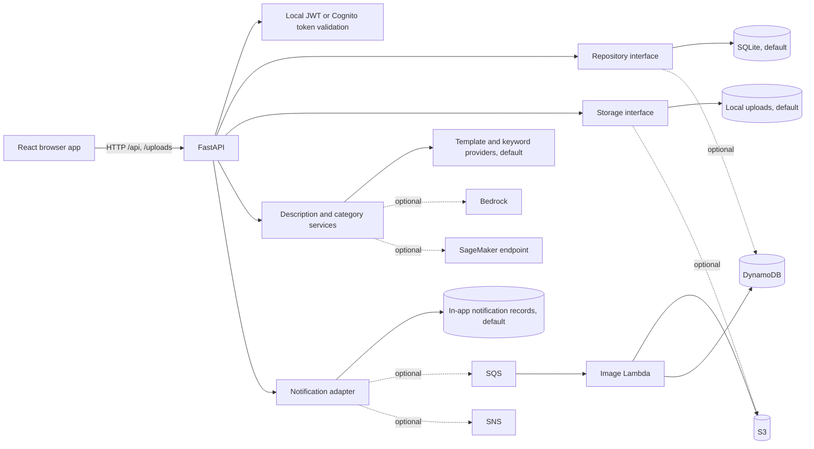

# CampusConnect architecture

## Current implementation

The browser uses the Vite development server and its `/api` and `/uploads` proxies. The FastAPI application exposes authentication, listing, upload, notification, assistant, health, and category routes. Router code delegates persistence and provider work to adapters selected from environment settings.

Solid paths are the local configuration. Dotted paths are integration code that can be selected by configuration. Terraform definitions are disabled by default in source; the current AWS stack is deployed in us-east-1 behind CloudFront and an ALB. The Lambda expects the source image in S3, a DynamoDB listing keyed as `LISTING#{id}` / `META`, and an SQS event source configured for `ReportBatchItemFailures`.

## Data and trust boundaries

Local passwords are hashed with PBKDF2-HMAC-SHA256. Local sessions use signed JWTs. Protected API routes use bearer tokens. Listing updates/deletes and upload attachment verify ownership. Public listing reads include the contact field, so deployments should review that product decision before exposing the service publicly.

In AWS mode, Cognito ID tokens are verified against the user pool issuer and app client. DynamoDB is expected to contain the profile and listing items and the named GSIs documented in `backend/app/dynamodb_repo.py`. Uploaded files are normalized to JPEG by the API before storage; the Lambda currently creates a further processed copy for queued image jobs.

## Runtime configuration

`APP_MODE` is descriptive and does not select providers by itself. Each `*_BACKEND`, `*_PROVIDER`, and `AUTH_MODE` setting selects its adapter independently. Defaults are local. The application does not silently substitute a local result when an AWS call fails. See `.env.example` for the complete setting list.

## Deployment status and remaining work

The live AWS integration uses Cognito, DynamoDB, S3, Bedrock for descriptions, local categories, and AWS notifications. The public health route returns HTTP 200. Both EC2 targets are healthy. Authenticated user flows and actual AWS data, image, message, and model operations remain to be verified. SageMaker is disabled; a trained model artifact and endpoint were omitted to conserve credits. See `docs/deployment-guide.md` and `docs/project-status.md` for evidence and limitations.
